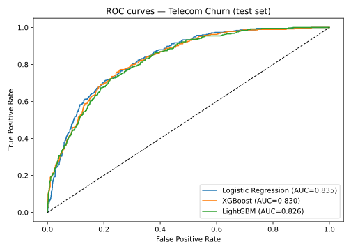
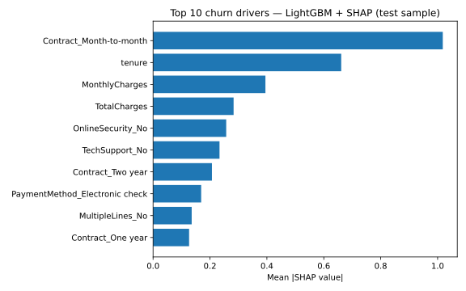
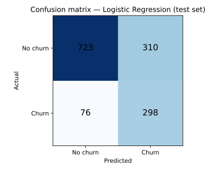

# Telecom Customer Churn Prediction

🚀 **Live demo:** [Try the app](https://wkntyf9xvvupgdezhbuzek.streamlit.app/)

Predict which telecom customers are likely to churn, so retention can be
targeted before they leave — with an interpretable model, not just a score.

## Results (test set, n = 1,407)

Stratified 80/20 train/test split (`random_state=42`), after dropping 11 rows
with blank `TotalCharges`. Metrics are for the **Churn** class; accuracy alone
is misleading here because only ~26.5% of customers churn.

| Model | ROC-AUC | Precision (Churn) | Recall (Churn) | F1 (Churn) | Accuracy |
|---|---|---|---|---|---|
| **Logistic Regression** | **0.8351** | 0.4901 | 0.7968 | 0.6069 | 0.7257 |
| XGBoost | 0.8302 | 0.5009 | 0.7781 | 0.6094 | 0.7349 |
| LightGBM | 0.8258 | 0.5241 | 0.7273 | 0.6092 | 0.7520 |

All three models land within 0.01 ROC-AUC of each other. Logistic Regression
wins on ranking (ROC-AUC) and recall; LightGBM wins on precision and accuracy.
No model is "best" on every metric — that is the honest finding, and the
reason the business decision (how many false alarms retention can afford)
should pick the operating threshold, not the model alone.

Reproduce: `python src/train.py` — it prints these numbers and writes
`metrics.json` plus the plots in `plots/`.

## What drives churn? (SHAP, LightGBM)

Mean |SHAP value| on a 300-row test sample — the top 5 drivers:

1. **Month-to-month contract** (1.018) — by far the strongest signal.
   Customers not locked into a term leave far more often.
2. **Tenure** (0.661) — newer customers churn more; risk falls with tenure.
3. **MonthlyCharges** (0.395) — higher monthly bills, higher churn.
4. **TotalCharges** (0.283) — cumulative spend, correlated with tenure.
5. **No OnlineSecurity** (0.257) — customers without the security add-on
   churn more, as do customers without TechSupport (rank 6).





Business takeaway: target month-to-month, low-tenure, high-bill customers
with a contract upgrade or a security/tech-support bundle — that is where
the model says the risk concentrates.

## Method

- **Cleaning:** `TotalCharges` coerced to numeric; 11 blank rows (tenure = 0)
  dropped. `customerID` removed — it must never be a feature.
- **Split:** stratified 80/20, so train and test keep the same churn rate.
- **Imbalance:** ~26.5% churn. Logistic Regression and LightGBM use
  `class_weight="balanced"`; XGBoost uses `scale_pos_weight = neg/pos`
  on the training set (2.76). No resampling of the test set.
- **Features:** 4 numeric (standardised for Logistic Regression) + 15
  categorical (one-hot encoded). Tree models use the same pipeline.
- **Evaluation:** ROC-AUC for ranking, plus Precision / Recall / F1 for the
  churn class at the default 0.5 threshold.

## Dataset

IBM Telco Customer Churn — `data/WA_Fn-UseC_-Telco-Customer-Churn.csv`,
7,043 rows, 21 columns. Churn: Yes 1,869 (26.5%), No 5,174 (73.5%).

> **Honest note:** this is an IBM **demo / educational dataset**, not
> production data from a real operator. The value here is the end-to-end
> method — cleaning, stratified evaluation, imbalance handling, and
> explainability — applied transparently, not the dataset itself.

Sources:
- https://porterncsu.github.io/PA-Class/Intro-Telco-Customer-Churn-Dataset.html
- https://www.analyticsvidhya.com/blog/2022/01/churn-analysis-of-a-telecom-company/

## Demo

```bash
pip install -r requirements.txt
streamlit run app.py
```

The demo trains the LightGBM model in memory on launch (no model binary is
stored in the repo) and predicts churn probability for a customer profile
you enter.

## Project structure

```
├── app.py                  # Streamlit demo
├── data/
│   └── WA_Fn-UseC_-Telco-Customer-Churn.csv
├── metrics.json            # measured test-set results (from src/train.py)
├── plots/
│   ├── roc_curves.svg
│   ├── confusion_matrix.svg
│   └── shap_top_drivers.svg
├── requirements.txt
└── src/
    └── train.py            # cleaning, training, evaluation, SHAP
```

## Limitations

- Single dataset, single split — results would need cross-validation and a
  holdout from a different period before any production claim.
- The 0.5 decision threshold is a default, not a tuned business choice;
  precision/recall trade off sharply around it.
- No cost model: retention offers cost money, and this repo does not price
  a false positive against a saved customer.
